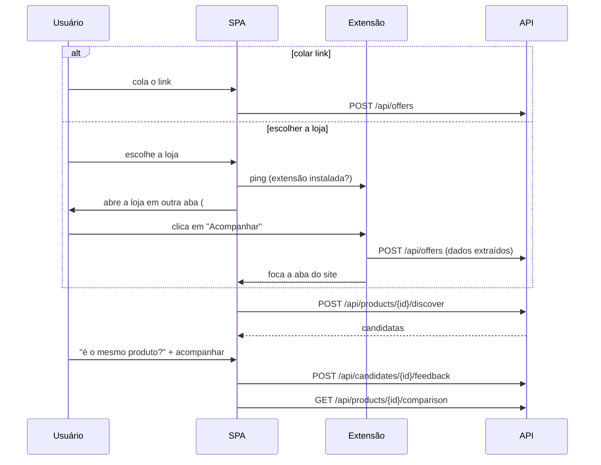

# PriceWatchSPA — Arquitetura

## Stack

| Camada | Tecnologia |
|---|---|
| Framework | Angular 20.3.10 |
| UI Components | Angular Material 20 (MD3) |
| Estilo | SCSS, Angular Material custom theme |
| Internacionalização | @ngx-translate/core v17 + @ngx-translate/http-loader v17 |
| Gráficos | Chart.js 4 (direto, sem wrapper) |
| HTTP | Angular HttpClient + interceptor funcional |
| Estado | Angular Signals (signal, computed) |
| Roteamento | Angular Router com lazy loading (loadComponent) |
| Deploy | Vercel |
| API | PriceWatch (.NET 8, REST, JWT HS256) |

## Estrutura de Pastas

```
src/app/
├── core/
│   ├── guards/          auth.guard, guest.guard
│   ├── interceptors/    auth.interceptor (JWT + 401)
│   └── services/        auth, notification-polling, theme, language, toast
├── shared/
│   ├── components/      confirm-dialog, empty-state, price-display, skeleton, source-badge
│   ├── models/          auth, product-list, tracked-product, notification, user, error-response
│   └── pipes/           price, relative-date
├── features/
│   ├── auth/            login, register, verify-email
│   ├── dashboard/
│   ├── lists/           list-overview, list-detail, list-analysis
│   ├── products/        add-product, edit-product, price-history
│   ├── notifications/
│   └── profile/         profile-overview, change-password, change-email, delete-account
└── shell/               layout autenticado (header + router-outlet)
```

## Rotas

```
/auth/login               pública (guest guard)
/auth/register            pública (guest guard)
/verify-email             pública sem guard
/dashboard                protegida (auth guard)
/lists                    protegida
/lists/:id                protegida
/lists/:id/analysis       protegida
/notifications            protegida
/profile                  protegida
/profile/change-password  protegida
/profile/change-email     protegida
/profile/delete-account   protegida
```

## Paleta de Cores (Mercado Livre inspired)

| Token CSS | Light | Dark |
|---|---|---|
| `--pw-yellow` | `#FFE600` | `#FFE600` |
| `--pw-bg` | `#EBEBEB` | `#1a1a1a` |
| `--pw-surface` | `#FFFFFF` | `#2d2d2d` |
| `--pw-success` | `#00A650` | `#00A650` |
| `--pw-error` | `#F23D4F` | `#F23D4F` |

## Diagrama de Arquitetura

```mermaid
graph TB
    subgraph Browser
        subgraph Core
            AS[AuthService\nsignal: currentUser]
            NPS[NotificationPollingService\ninterval 30s]
            AI[auth.interceptor\nJWT + 401 handler]
            TS[ThemeService\ndark/light]
            LS[LanguageService\npt-BR / en]
        end

        subgraph Shell
            HDR[Header\nbadge + toggle tema/idioma]
            OUT[router-outlet]
        end

        subgraph Features
            DASH[Dashboard]
            LISTS[Lists]
            PRODS[Products + Chart.js]
            NOTIF[Notifications]
            PROF[Profile]
        end
    end

    subgraph PriceWatch API
        AUTH_EP[/api/auth/*]
        LISTS_EP[/api/lists/*]
        PRODS_EP[/api/lists/:id/products/*]
        NOTIF_EP[/api/notifications/*]
        USERS_EP[/api/users/me*]
    end

    AS --> AI
    DASH --> LISTS_EP & NOTIF_EP
    LISTS --> LISTS_EP
    PRODS --> PRODS_EP
    NOTIF --> NOTIF_EP
    PROF --> USERS_EP
    NPS --> NOTIF_EP
    NPS --> HDR
```

## Evolução planejada para a v1 (02/10/2026)

Nada abaixo está implementado. Detalhes de API em `priceWatchAPI/docs/arquitetura.md` ("Arquitetura da v1").

### Features novas

```
features/
├── add-offer/            colar link, seletor de lojas, detecção da extensão
├── products/
│   ├── product-comparison/   ofertas lado a lado + destaque da mais barata + frescor
│   └── candidate-review/     candidatas encontradas + "é o mesmo produto?" + acompanhar
└── notifications/        evolução: canal de entrega e preferências
```

Reaproveitam `SourceBadgeComponent`, `ProductCardComponent`, `PriceDisplayComponent` e `EmptyStateComponent`. `ProductLinkDialogComponent.openUrl()` passa a chamar o redirect da API em vez de `window.open(product.url)`.

### Rotas novas

```
/add                              protegida — colar link ou escolher a loja
/products/:id/comparison          protegida — comparação lado a lado
/products/:id/candidates          protegida — confirmação das candidatas
```

### Fluxo do usuário



### Serviços novos (`core/services`)

| Serviço | Papel |
|---|---|
| `extension-bridge` | Ping e mensagens com a extensão (detecta instalação, recebe o retorno do fluxo "abrir loja") |
| `store-catalog` | Carrega `GET /api/stores` (lojas e capacidades) |
| `offer` / `candidate` | Chamadas de `/api/offers`, `/api/products/{id}/discover`, `candidates`, `feedback` |

### Deploy

Migrar da Vercel (plano gratuito não permite uso comercial) para a Cloudflare Pages, mantendo a URL da API em `environment.prod.ts`. A paleta atual (inspirada no Mercado Livre) é reavaliada junto com a identidade da landing e do app.

## Decisões Técnicas

| Decisão | Escolha | Motivo |
|---|---|---|
| JWT storage | localStorage | Backend não suporta httpOnly cookie |
| Token expiry | Decode local antes de cada request | Evita request com token já expirado |
| Polling | RxJS interval(30s) + takeUntilDestroyed | Backend sem SSE/WebSocket |
| Charts | Chart.js direto (sem wrapper) | ng2-charts requer Angular 21+ |
| Toasts | MatSnackBar via ToastService | Reaproveitamento do Material |
| Tema | mat.theme() com class="dark" no html | Padrão MD3 para dark/light |
| Idioma | navigator.language + localStorage | UX automática sem perguntar |
| State | Signals (signal, computed) | Escala suficiente, sem NgRx |
| ngx-translate | v17 com provideTranslateService() | Nova API standalone-friendly |
